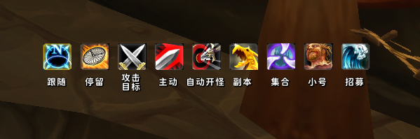
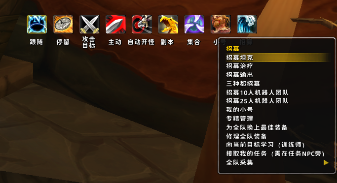
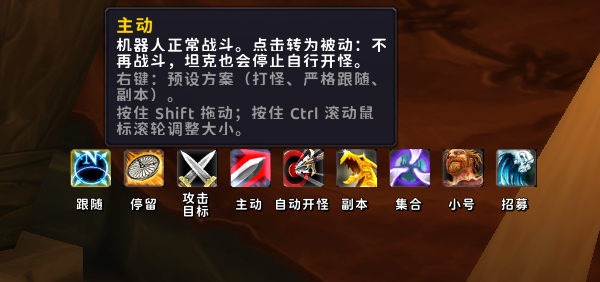
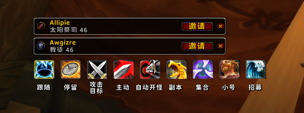
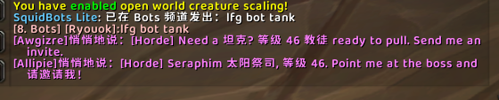

# SquidBots Lite 2.5 中文汉化版

> [!NOTE]
> 本汉化版基于 Arden 启动器提供的最新版 SquidBots Lite（2.5），并针对飞升 Arden 客户端进行了中文本地化和问题修复。部分功能依赖服务端支持，能否使用以 Arden 服务端实际提供的功能为准。
>
> 较新版本的 SquidBots Lite 也可以在 Arden 客户端加载，但部分功能可能因服务端兼容性而无法使用。**如果你玩的是 Arden，建议下载本仓库提供的版本。**

## 🧭 新功能 · 小地图图标

用小地图上的 **SquidBots Lite** 图标随时展开或收起机器人界面。更新插件后，可在游戏中输入 `/reload`，然后在小地图边缘找到图标。

- **左键点击**打开机器人指令栏，可使用跟随、停留、攻击目标、自动开怪、小号管理和招募等功能。
- **再次左键点击**收起指令栏和已打开的小号、专精及机器人管理窗口。收到招募回复时，隐藏的指令栏会保持收起。
- **按住左键拖动**可沿小地图边缘移动图标。图标位置和指令栏的显示状态会按角色保存。

## 🎮 插件功能

本版保留机器人管理面板和按角色独立保存设置的功能。主界面及机器人管理面板均已汉化，可用 `/sbl lang zh` 切换为中文。攻击目标按钮采用两行显示，并修复了缺少职责数据时出现问号的问题。

新功能入口：/sbl bot、/sbl spec、/sbl alts；机器人图标菜单也保留官方功能。部分银行、坐骑、天赋和账号功能需要对应服务端支持。

## 📦 安装

先备份游戏目录中的 `SquidBotsLite` 和 `WTF` 中的同名存档。将插件放入 `Interface/AddOns`，确认插件目录名为 `SquidBotsLite`。避免同时启用两版。

## 📸 游戏内实机截图

### 机器人指令栏

### 招募菜单

点击指令栏的「招募」，可按坦克、治疗或输出招募，也可进入小号和专精管理。

### 主动模式提示

鼠标悬停在「主动」按钮上，可查看主动和被动模式的区别，以及切换预设、拖动和缩放的操作提示。

### 招募回复与邀请

机器人回复招募后，指令栏上方会显示邀请提示，点击「邀请」即可发出组队邀请。招募频道和机器人的私聊回复也可在聊天窗口查看。

