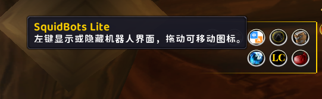

# SquidBots Lite 2.5 中文汉化版

以官方下载2.5为基础，保留Manager.lua全部功能和角色独立存档。主界面及机器人管理面板均加入中文；语言设置可用 /sbl lang zh。攻击目标使用两行显示。优先使用游戏实际职责，修复了无职责数据时显示问号的bug。

新功能入口：/sbl bot、/sbl spec、/sbl alts；机器人图标菜单也保留官方功能。部分银行、坐骑、天赋和账号功能需要对应服务端支持。

安装：先备份游戏目录SquidBotsLite和WTF中的同名存档，将本文件夹放入Interface/AddOns，确认目录名为SquidBotsLite。避免同时启用两版。

## 游戏内实机截图

### 小地图图标

左键点击小地图图标可显示或隐藏机器人界面，按住左键拖动可调整图标位置。图标位置和指令栏显隐状态按角色保存。

### 机器人指令栏

点击图标后可使用跟随、停留、攻击目标、自动开怪、集合、小号和招募等功能。再次点击图标会收起指令栏及已打开的管理窗口。

### 招募菜单

点击指令栏的「招募」，可按坦克、治疗或输出招募，也可进入小号和专精管理。

### 主动模式提示

鼠标悬停在「主动」按钮上，可查看主动和被动模式的区别，以及切换预设、拖动和缩放的操作提示。

### 招募回复与邀请

机器人回复招募后，指令栏上方会显示邀请提示，点击「邀请」即可发出组队邀请。招募频道和机器人的私聊回复也可在聊天窗口查看。

