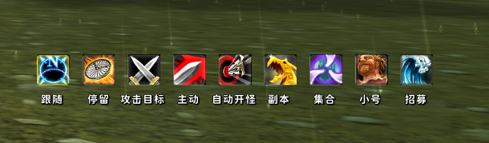
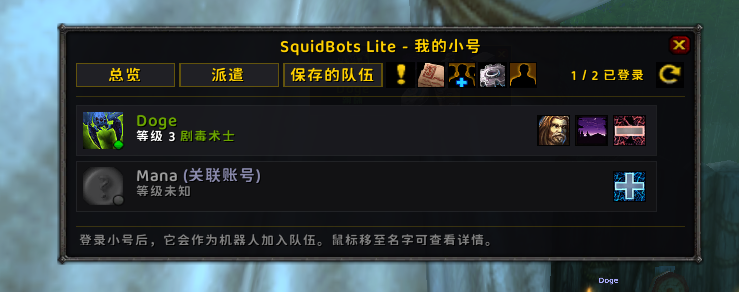
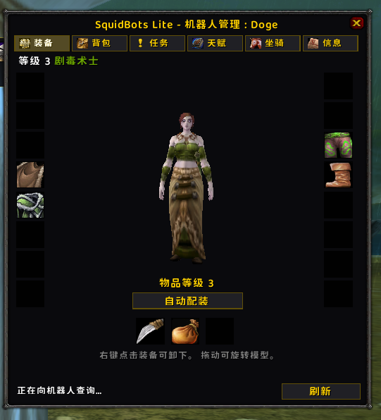
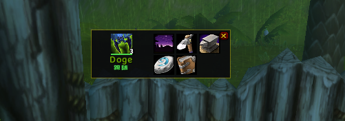

# SquidBots Lite 2.9.4 中文汉化版

> [!NOTE]
> 本版以 SquidBots Lite 2.9.4 为基础，适用于飞升 Arden 客户端。采集派遣、副本清理和主坦克等功能需要相应的服务端支持。旧版仍可在 [2.5 中文适配版发布页](https://github.com/moshoutegong/SquidBots-Lite-2.5-CN/releases/tag/v2.5.0) 下载。

**汉化整合：B站魔兽特工**

## 🧭 小地图开关

左键点击小地图上的 SquidBots Lite 图标，可展开或收起机器人指令栏及已打开的管理窗口。按住左键拖动可移动图标。图标位置和指令栏的显示状态按角色保存。

## 📝 2.9.4 更新说明

- 保留旧版中文译文和小地图开关，补译新版的「我的小号」、小号总览、采集派遣、队伍任务、训练师、副本清理和主坦克等界面。
- 恢复旧版指令栏字号和描边，拉开按钮间距，「攻击目标」和「自动开怪」均为单行显示。
- 恢复 Bots 招募频道。插件会尝试自动加入 **Bots**，未加入时会提示稍后重试，避免把招募发到 NewcomersCN。使用 `/sbl channel` 可恢复默认频道。
- 在插件列表中显示 **SquidBots Lite(机器人管理)**，并在「关于」末尾加入汉化署名。

## 📦 安装

1. 从 [2.9.4 发布页](https://github.com/moshoutegong/SquidBots-Lite-2.5-CN/releases/tag/v2.9.4) 下载 `SquidBotsLite-v2.9.4-CN.zip`。
2. 备份原插件和 `WTF` 中的同名存档，将 ZIP 内的 `SquidBotsLite` 文件夹放进客户端的 `Interface/AddOns`。
3. 完整重启客户端。需要切换为简体中文时，输入 `/sbl lang zh`。

## 📸 游戏内实机截图

### 机器人指令栏

### 我的小号

### 机器人管理

### 小号队伍栏

